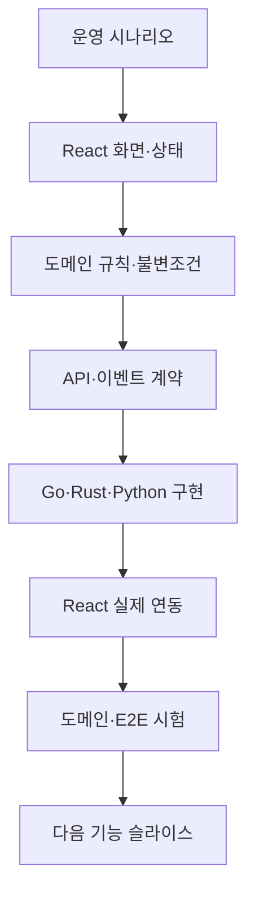

# SentinelGrid V01 도메인 수직 슬라이스 개발 가이드

## 1. 개발 방식

SentinelGrid는 프론트엔드를 전부 만든 뒤 백엔드를 붙이거나, 반대로 백엔드 기반을 모두 만든 뒤 화면을 추가하지 않는다. **운영 도메인과 사용자 기능을 하나씩 선택하고, 프론트엔드와 백엔드를 번갈아 구현하면서 실제 동작하는 수직 슬라이스를 완성한다.**



핵심 단위는 기술 계층이 아니라 다음과 같은 사용자 기능이다.

- 운영상황도에서 순찰체 상태 확인
- 순찰구역과 임무 생성
- 텔레메트리 신선도 판단
- 명령 요청·승인·결과 확인
- 사건 후보 확인·조치·종결
- 장애 당시 상태 재현

## 2. 수직 슬라이스 공통 순서

각 기능은 다음 순서로 개발한다.

1. **시나리오 정의**: 사용자, 시작 조건, 행동, 성공·실패 결과를 적는다.
2. **UI 초안**: React에서 필요한 화면, 상호작용, 오류 상태를 Mock으로 확인한다.
3. **도메인 모델**: Aggregate, 상태 전이, 불변조건, `UNKNOWN` 조건을 정의한다.
4. **계약 작성**: TypeScript schema에서 필요한 HTTP·WebSocket·이벤트 계약을 확정한다.
5. **서비스 구현**: 기능 책임에 따라 Go, Rust 또는 Python으로 최소 구현한다.
6. **실제 연동**: Mock handler를 실제 API로 교체한다.
7. **검증**: UI 시험, 도메인 시험, contract test, 장애 시나리오를 통과한다.
8. **기록**: ADR, 제한사항, 관측 지표와 다음 개선점을 남긴다.

UI와 백엔드는 하루 단위로 기계적으로 교대하지 않는다. 한 기능 안에서 Mock UI가 도메인을 발견하고, 백엔드 구현 결과가 다시 UI 상태를 보완하는 짧은 피드백 루프를 만든다.

## 3. 도메인별 개발 순서

| 순서 | 도메인 슬라이스 | 프론트엔드 | 백엔드·데이터 |
|---:|---|---|---|
| 1 | Operational Picture | 지도·순찰체·신선도 | Go snapshot API, PostgreSQL |
| 2 | Patrol Mission | 구역·경로·배정·coverage | Go Mission, PostGIS |
| 3 | Telemetry Reliability | 부분 갱신·단절·재접속 | Python Simulator, Rust Gateway, Go projection |
| 4 | Command & Control | 요청·승인·진행·결과 | Go Lease·Command, Rust result path |
| 5 | Incident Management | 후보·근거·담당·종결 | Go Incident, Python analysis |
| 6 | Replay & Audit | 타임라인·상태 재현 | event replay, audit query |

## 4. 슬라이스 완료 정의

기능은 화면이 보이거나 API가 응답한다고 완료되지 않는다. 다음 조건을 모두 충족해야 한다.

- 운영자가 수행할 행동과 실패 상태가 화면에 표현된다.
- 도메인 상태 전이와 불변조건 시험이 통과한다.
- API·이벤트 schema와 실제 응답이 일치한다.
- Mock과 실제 API가 같은 UI 상태를 만든다.
- 중복, 지연, 권한 오류 등 해당 기능의 대표 장애가 시험된다.
- 로그·metric·trace에서 기능 흐름을 추적할 수 있다.
- README 또는 ADR에 결정과 제한사항이 남는다.

## 5. 프론트엔드 구현 원칙

- React와 strict TypeScript를 사용한다.
- 서버 상태와 화면 로컬 상태를 분리한다.
- Zod 등으로 런타임 응답을 검증한다.
- 정상뿐 아니라 loading, empty, stale, missing, denied, unknown을 함께 만든다.
- API 응답 DTO를 컴포넌트가 직접 소비하지 않고 UI model adapter를 거친다.
- Mock은 설계 도구로 사용하되 실제 연동 뒤 불필요한 이중 구현은 제거한다.

## 6. 백엔드 구현 원칙

- Go가 Mission, Command, Incident와 최신 운영상황의 System of Record다.
- Rust는 외부 텔레메트리와 명령 결과를 검증·조절하는 통신 경계다.
- Python은 재현 가능한 시뮬레이션과 분석·RAG를 담당하며 명령 권한을 갖지 않는다.
- PostgreSQL/PostGIS는 트랜잭션·공간 원장, Redis Streams는 비동기 전달에 사용한다.
- 기능에 필요하지 않은 공통 프레임워크와 추상화를 미리 만들지 않는다.

## 7. 브랜치·커밋 단위

브랜치는 기술 계층이 아니라 기능 단위로 만든다.

```text
feature/operational-picture
feature/patrol-mission
feature/telemetry-freshness
feature/command-lifecycle
feature/incident-workflow
feature/replay-audit
```

한 기능 브랜치 안에서 React, Go, Rust, Python, schema, test 변경이 함께 발생할 수 있다. PR에는 사용자 시나리오, 화면 캡처, API 변경, 시험 결과와 운영상 제한을 함께 기록한다.

## 8. Docker Compose 적용

첫 번째 Operational Picture 슬라이스에서 React와 Go, PostgreSQL을 연결할 때 최소 Compose 구성을 만든다. 이후 기능이 추가될 때 Rust, Redis, Python, 관측 도구를 profile로 확장한다.

즉, 첫날 인프라만 구성하지도 않고 모든 기능을 만든 뒤 마지막에 통합하지도 않는다. Compose 역시 각 수직 슬라이스가 실제 실행되는 데 필요한 만큼 점진적으로 확장한다.

## 9. 하지 않을 방식

- 전체 화면을 Mock으로 완성한 뒤 백엔드를 한꺼번에 연결하지 않는다.
- 모든 API와 DB 테이블을 먼저 설계하지 않는다.
- 언어 사용 자체를 목표로 불필요한 서비스를 추가하지 않는다.
- 공용 모듈과 추상화를 세 번 이상 반복되기 전에 성급히 만들지 않는다.
- 기능 완료 전에 다음 기능으로 넘어가 미완성 계층을 쌓지 않는다.

V01의 진척도는 작성한 파일 수가 아니라 **완료된 도메인 수직 슬라이스와 검증 증거**로 측정한다.
