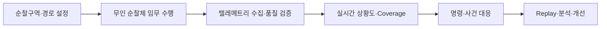

[[Project/Solo Project/Drone&Air_Project/SentinelGrid_기획문서/README|README]]

[[SentinelGrid_개발과정]]
[[SentinelGrid_종합기획문서]]
[[SentinelGrid_도메인지식정리]]
[[SentinelGrid_관련기술정리]]

[[01_초기_개발환경_세팅]]
[[00_도메인_수직슬라이스_개발_가이드]]


---
# SentinelGrid — 지정구역 무인 순찰·상황인지 플랫폼

> **도시·공장 등 지정된 구역을 무인 순찰체가 반복 순찰하고, 신뢰 가능한 텔레메트리를 기반으로 임무·통신 장애·이상 상황을 실시간 관리하는 지능형 관제 플랫폼**

## 프로젝트 개요

SentinelGrid는 공원·하천·도로 같은 도시 공공구역과 공장 외곽·창고·설비 구역 같은 산업부지를 가상 무인 순찰체가 순찰하는 상황을 구현한다. 단순히 지도에 기체 위치를 표시하는 데 그치지 않고, **해당 정보가 현재도 신뢰할 수 있는지, 실제로 어느 구간까지 순찰했는지, 명령이 목표 상태까지 수행됐는지**를 운영자가 판단할 수 있도록 설계한다.

초기 MVP는 가상 UAV를 사용하며, 이후 지상 순찰 로봇·고정 센서·현장 카메라를 `PatrolUnit`으로 확장할 수 있다. 실제 비행제어, 얼굴 인식, 개인 추적, 무장·공격 자동화는 범위에서 제외한다.


![[Pasted image 20261111212341.png|700]]


## 해결하려는 문제

- 오래되거나 부분 갱신된 데이터를 현재 상태로 오인하는 문제
- 통신 단절 중 임무를 지속·중단하고 재접속 후 상태를 복구하는 문제
- 다중 운영자의 통제권과 상충하는 명령을 관리하는 문제
- 명령 전송·수락과 실제 실행 완료를 구분하는 문제
- 순찰체 이탈 시 미순찰 구간과 대체 가능 자원을 파악하는 문제
- 반복 경보를 사건 단위로 묶고 사후에 운용 판단을 재구성하는 문제

## 핵심 운용 흐름

````

````
![[Pasted image 20261111211939.png|700]]


## 주요 기능

| 영역     | 주요 기능                                       |
| ------ | ------------------------------------------- |
| 순찰 임무  | 구역·경로·체크포인트, 기체 배정, 진행률·미순찰 구간 계산           |
| 운영상황도  | 위치·배터리·통신·센서 상태와 필드별 Freshness 표시           |
| 통신 신뢰성 | 중복·역순·지연 이벤트 처리, 단절 정책, 재접속 Reconciliation  |
| 명령·통제  | 통제권, 승인, 만료, 멱등성, 요청부터 목표 상태 도달까지 추적        |
| 사건관리   | 이상 후보, 근거, 확인·기각·조치·종결 이력과 반복 경보 묶음         |
| AI·분석  | 이상 후보 탐지, SOP·이벤트 기반 RAG 설명, 규칙 기반 Fallback |
| 감사·재현  | 텔레메트리·명령·정책·모델·운영자 조작을 연결한 Timeline Replay  |

## 시스템 구성

|구성|역할|
|---|---|
|React·TypeScript|지도 기반 관제, 임무·명령·사건·Replay 화면|
|Go|임무·통제권·명령·사건·감사 기록의 System of Record|
|Rust|텔레메트리 검증, 장치 세션, 우선순위·Backpressure 처리|
|Python|가상 순찰 시뮬레이션, 이상 탐지, RAG·LLM, MLOps|
|PostgreSQL·PostGIS|임무·공간·명령·감사 원장|
|Redis Streams|텔레메트리와 비동기 이벤트 전달|
|Docker Compose|개발·통합시험·데모·단일 서버 실행환경|

## 핵심 설계 원칙

순찰체의 물리적 상태와 데이터 품질을 분리하고, 근거가 부족하면 정상·위험을 단정하지 않고 `UNKNOWN`으로 표시한다. AI는 설명과 이상 후보 탐지를 지원하지만 명령 권한을 갖지 않는다. 원본 영상보다 필요한 사건 메타데이터를 우선하며, 모든 명령·정책·모델·운영자 조작은 사후 추적 가능하게 기록한다.

개발은 기술 계층별로 분리하지 않고 **Operational Picture → Patrol Mission → Telemetry Reliability → Command & Control → Incident Management → Replay & Audit** 순서의 도메인 수직 슬라이스로 진행한다. 각 슬라이스에서 React 화면, 도메인 규칙, API·이벤트 계약, Go·Rust·Python 구현과 통합시험을 함께 완료한다.

## V01 완료 결과

가상 순찰체가 도시형·산업부지형 경로를 수행하고, 통신 단절·중복·역순 이벤트와 명령 ACK 유실이 발생해도 최신 상태와 신선도를 복원한다. 운영자는 한 화면에서 순찰 진행률, 미확인 구간, 결과 미확인 명령, 이상 사건의 근거와 대응 이력을 구분해 확인할 수 있다.