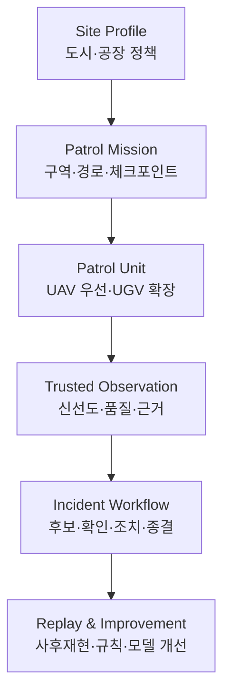

# 프로젝트 정체성 및 네이밍

## 1. 프로젝트명

**SentinelGrid**

- `Sentinel`: 이상 상황을 지속적으로 관찰하는 감시자
- `Grid`: 하나의 기체가 아니라 구역·경로·순찰체·센서·관제소가 연결된 운영망

한글 설명은 **지정구역 무인 순찰·상황인지 플랫폼**으로 통일한다. 감시라는 표현만 사용하면 사람을 대상으로 한 감시 시스템으로 오해될 수 있으므로, 문서에서는 시설·환경·안전 상태를 관찰하는 `순찰·상황인지`를 우선 사용한다.

## 2. 해결하려는 문제

도시와 공장에서는 넓은 구역을 반복 확인해야 하지만, 단순히 순찰체를 지도 위에 표시하는 것만으로는 다음 질문에 답할 수 없다.

- 해당 구역이 실제로 순찰됐는가?
- 표시된 위치와 센서 정보는 지금도 신뢰할 수 있는가?
- 통신이 끊긴 동안 임무와 명령은 어떻게 처리됐는가?
- 발견된 이상은 확인된 사실인가, 분석 모델의 후보인가?
- 한 순찰체가 이탈하면 어느 구간이 비고 누가 대체할 수 있는가?

SentinelGrid는 순찰 자동화 자체보다 이 질문에 검증 가능한 데이터와 상태 전이로 답하는 것을 목적으로 한다.

## 3. 제품 개념

## 4. 두 가지 Site Profile

| 구분 | 도시형 | 산업부지형 |
|---|---|---|
| 대상 | 공원, 하천, 도로, 행사·재난 구역 | 외곽 펜스, 창고, 야적장, 설비 주변 |
| 주요 사건 | 침수·연기·통행 장애·미순찰 | 열·연기·시설 손상 후보·침입 흔적 |
| 주요 제약 | 프라이버시, GNSS 음영, 유동 인구 | OT망 분리, 금속 간섭, 열원·분진 |
| 공통 원칙 | 최소 수집, 운영자 확인, 안전한 중단·복귀 | 최소 수집, 운영자 확인, 안전한 중단·복귀 |

## 5. 프로젝트 경계

V01은 합성 데이터와 가상 UAV를 이용한 관제·검증 플랫폼이다. 실제 비행 승인, 실제 영상 식별, 현장 제어기 연동은 포함하지 않는다. 실기체 단계는 별도 안전·법규·시설 정책 검증을 통과한 뒤 확장한다.
