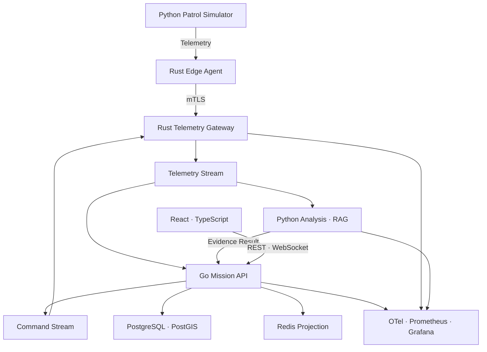

# 시스템 아키텍처

## 1. 논리 구조

## 2. 배포 단위

| 서비스 | 책임 | 장애 시 영향 |
|---|---|---|
| `mission-api` | 임무·명령·상황도·사건·감사 | 새 상태 변경 제한 |
| `telemetry-gateway` | 연결·검증·QoS·재접속 | 수집 지연, Command 전달 제한 |
| `patrol-simulator` | 가상 기체·환경·장애 주입 | 시험 데이터 생성 중단 |
| `analysis-service` | 이상 후보·RAG·LLM | 규칙 기반 Fallback |
| `web-console` | 관제·승인·Replay UI | API는 계속 운영 |
| `event-worker` | Projection·Timeout·Incident | Event 적체 후 재처리 |

## 3. 신뢰 구역

- Platform/Edge Zone: Python Simulator, Rust Edge Agent
- Device DMZ: Rust Gateway, mTLS, Rate Limit
- Mission Zone: Go Mission API, Worker
- Data Zone: PostgreSQL/PostGIS, Redis
- AI Zone: Python Analysis, MLflow, Vector Index
- Management Zone: CI Runner, Registry, 관측 도구

AI Zone과 Telemetry 발행 계정에는 Command 생성 권한을 부여하지 않는다.

## 4. 통신 원칙

- 외부 Wire Frame과 내부 Domain Event를 분리한다.
- Telemetry는 At-least-once를 가정하고 멱등 처리한다.
- Command는 `command_id`, nonce, expiry, target과 policy version을 가진다.
- 연결 복구와 상태 복구를 구분한다.
- 느린 UI Client에는 위치 Event를 병합하되 Incident·Command Event는 보존한다.
